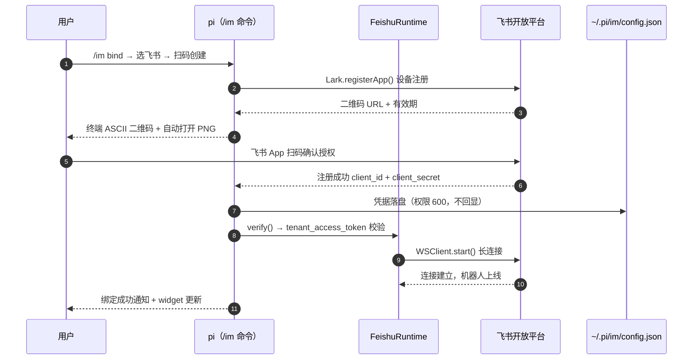
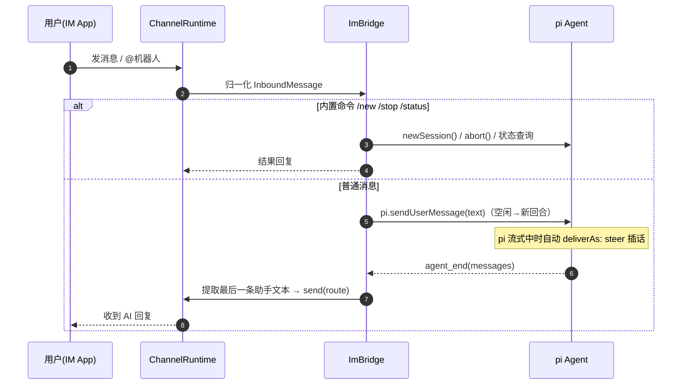

# pi-im

给 [pi](https://github.com/earendil-works/pi) 用的 IM 机器人插件：**扫码绑定机器人，把 IM 消息接入 pi 会话，AI 回复自动发回原聊天**。

设计参考 [dsh-im](https://github.com/xmanrui/dsh-im)（DeepSeek Harness 的 IM 插件），把"去各平台后台创建机器人"的过程封装成插件内扫码授权。

## 支持渠道（10 个）

| 渠道 | 接入方式 | 收消息 | 发消息 |
|---|---|---|---|
| Telegram | BotFather token | 长轮询 | sendMessage |
| 飞书 | **扫码创建**（Lark 设备注册）或 App ID + Secret | SDK WebSocket 长连接 | OpenAPI（**交互卡片**：原生表格/markdown 渲染，失败降级纯文本） |
| 钉钉 | **扫码设备注册**或 Client ID + Secret | dingtalk-stream 长连接 | sessionWebhook |
| 企业微信 | **扫码创建智能机器人**或 Bot ID + Secret | 官方 aibot SDK WebSocket | sendMessage |
| QQ | **扫码创建**（腾讯 connector）或 AppID + AppSecret | qqbot-nodejs WebSocket | sendText |
| Slack | Bot Token + App Token（Socket Mode） | 原生 Socket Mode（全局 WS） | chat.postMessage |
| Discord | Bot Token | 原生 Gateway v10（全局 WS） | REST |
| WhatsApp | **扫码关联设备**（Baileys） | WhatsApp Web 长连接 | sendMessage |
| iMessage | 仅 macOS，本机 Messages.app | 轮询 chat.db | osascript |
| 微信个人号 | **扫码登录**（iLink 智能机器人，支持配对码验证） | 长轮询增量同步 | sendmessage（1800 字分段） |

## 安装

### 推荐：从 GitHub 安装

```sh
pi install git:github.com/zhaoyaoyuan/pi-im
```

安装后重启 pi。升级流程：

```sh
cd 本地仓库 && git pull   # 或本地改完 push 后
pi update --extensions    # 同步 git 检出副本到最新
# 重启 pi
```

### 开发：本地目录

```sh
# 单次试用（不写入 settings）
pi -e ./pi-im

# 或正式安装本地路径
pi install ./pi-im
```

依赖（`@larksuiteoapi/node-sdk`、`dingtalk-stream`、`qrcode` 等）会在安装时自动装入。

## 使用

```text
/im                交互式管理
/im bind           绑定新机器人（选渠道 → 扫码或填凭据）
/im list|status    查看机器人与连接状态
/im connect [渠道]  连接（默认全部）
/im disconnect [渠道]
/im remove         移除机器人（删除凭据）
/im test           向机器人最近聊天发连接测试消息
```

绑定成功后：
- 机器人在 IM 中收到的消息会**注入当前 pi 会话**（空闲时开启新回合；pi 正在流式输出时自动转为 steer 插话）；
- 回合结束后，**最终回复自动发回发起消息的聊天**；
- IM 侧内置命令：`/new`（新会话）、`/stop`（停止）、`/status`、`/steer <内容>`、`/help`；
- 状态栏 widget 显示在线机器人数。

## 架构

```text
extensions/im.ts          入口：/im 命令、绑定流程、生命周期、状态 widget
src/
├── bridge.ts             IM ↔ pi 桥：入站注入（sendUserMessage/steer）、回复路由（agent_end）
├── commands.ts           IM 侧命令解析（/new /stop /status /steer /help）
├── store.ts              机器人与凭据持久化（~/.pi/im/config.json，权限 600）
├── ui.ts                 绑定二维码展示（终端 ASCII + PNG 自动打开）
├── types.ts              ChannelRuntime 接口与工具
└── channels/
    ├── telegram.ts       Bot API 长轮询
    ├── feishu.ts         Lark SDK WS + OpenAPI（interactive 卡片优先）
    ├── feishu-md.ts      markdown → 飞书卡片转换（标题加粗/表格→table 组件/自动分片）
    ├── feishu-registration.ts  飞书扫码注册状态机（移植自 dsh-im）
    ├── dingtalk.ts       dingtalk-stream 运行时
    ├── dingtalk-device-auth.ts 钉钉扫码设备注册协议（移植自 dsh-im）
    ├── wecom.ts          企微 aibot SDK 运行时
    ├── wecom-qr-auth.ts  企微扫码注册协议（移植自 dsh-im，含域名白名单）
    ├── qq.ts             腾讯官方 qqbot-nodejs 运行时
    ├── slack.ts          原生 Socket Mode（无额外依赖）
    ├── discord.ts        原生 Gateway v10（无额外依赖，协议移植自 dsh-im）
    ├── whatsapp.ts       Baileys 关联设备（扫码 link）
    ├── weixin.ts         iLink 长轮询运行时
    ├── weixin-api.ts     微信个人号协议（移植自 dsh-im：登录/增量/发送，含微信域白名单）
    └── imessage.ts       macOS Messages.app（chat.db 轮询 + osascript）
skills/im/SKILL.md        教 agent 协助用户管理机器人
```

新增渠道只需实现 `ChannelRuntime`：

```ts
export interface ChannelRuntime {
	readonly channel: ChannelId;
	readonly botId: string;
	start(): Promise<void>;          // 建长连接/轮询
	stop(): Promise<void>;
	send(route: Route, text: string): Promise<void>;
	healthy(): boolean;
}
```

在 `extensions/im.ts` 的 `startBot()` 加一个分支、`bindFlow()` 加一个入口即可。

## 流程时序图

### 扫码绑定（以飞书为例）



### 消息闭环



## 设计决策（对比 dsh-im）

| 决策 | 说明 |
|---|---|
| 飞书富文本 | AI 的 markdown 回复转 schema 2.0 交互卡片：表格→原生 table 组件、标题→加粗、代码块/列表/链接保留；卡片发送失败自动降级纯文本，超过元素/体积上限自动分片 |
| 共享会话模式 | MVP 采用"IM 消息注入当前 pi 会话"，多聊天消息按到达顺序串行进入同一会话；每个聊天可随时 `/new` 开新会话。dsh-im 式的"每聊天独立 Session"可基于 pi SDK `createAgentSession()` 后续扩展 |
| 凭据单向流 | Secret 只写 `~/.pi/im/config.json`（0600），状态查询与 UI 不回显凭据；WhatsApp 会话密钥独立目录 `whatsapp-session/` |
| steer 复刻 | pi 流式期间 IM 新消息自动转为 steer 插话，对应 dsh-im 的"插话"模式；排队模式待后续加开关 |
| 协议移植 | 飞书/钉钉/企微/QQ 扫码注册协议直接移植 dsh-im 已验证实现；企微扫码地址做 `work.weixin.qq.com` 域名白名单校验 |
| 依赖取舍 | Slack/Discord 用 Node 22+ 全局 WebSocket 原生实现，不引 discord.js/slack SDK；iMessage 零依赖 |

## 已知限制

- 图片/文件消息暂不解析（仅文本）；图片输入可在收到后扩展为 `ImageContent` 注入。
- 钉钉主动发送依赖 sessionWebhook，机器人需先收到过该会话消息。
- Telegram 需能直连 api.telegram.org（或启动 pi 前设 `HTTPS_PROXY`）。
- 回复为最终文本一次性发送（分段 3500 字符），流式编辑呈现待扩展。
- WhatsApp 默认仅响应**账号自聊**（给自己发消息当输入入口），避免误回联系人；群聊不处理。
- iMessage 需在系统设置授予「完全磁盘访问」与「自动化」权限；回复带 `🤖 pi-im` 前缀防回声。
- QQ 频道（guild）消息暂不处理，仅 c2c 与群聊。
- Discord 群聊仅响应 @机器人；需在 Developer Portal 开启 Message Content Intent。
- Slack 需自建 App：开启 Socket Mode、订阅 `message`/`app_mention` 事件并安装到工作区。
- 企业微信智能机器人回复走 markdown 消息类型（SDK SendMsgBody 不含纯文本）。
- 微信个人号仅支持文本与语音转写（图片/文件暂不解析）；凭据失效（ret=-14）后需移除重新扫码；同一微信号在别处登录会使本机 token 失效。
- 微信回复需带消息自带的 context_token（运行时自动记忆），首次回复前需先收到过该联系人消息。

## 开发

```sh
npm install
npm run check        # tsc --noEmit
```
